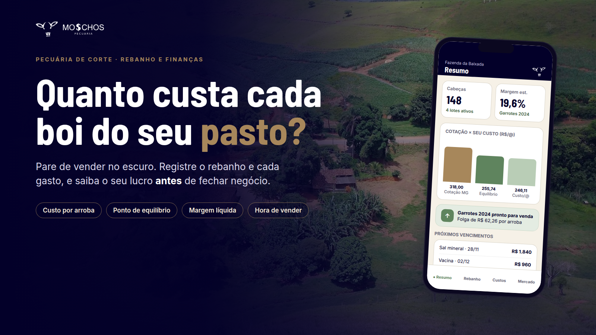
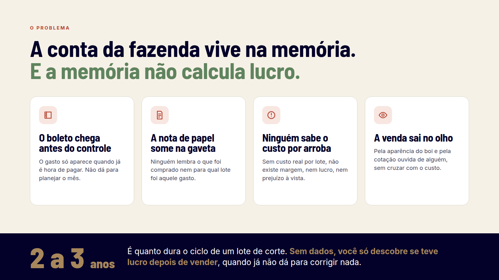
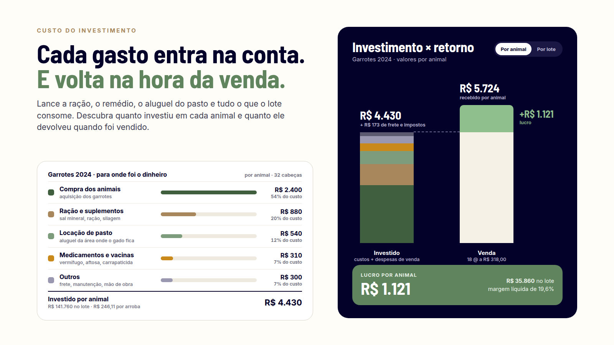
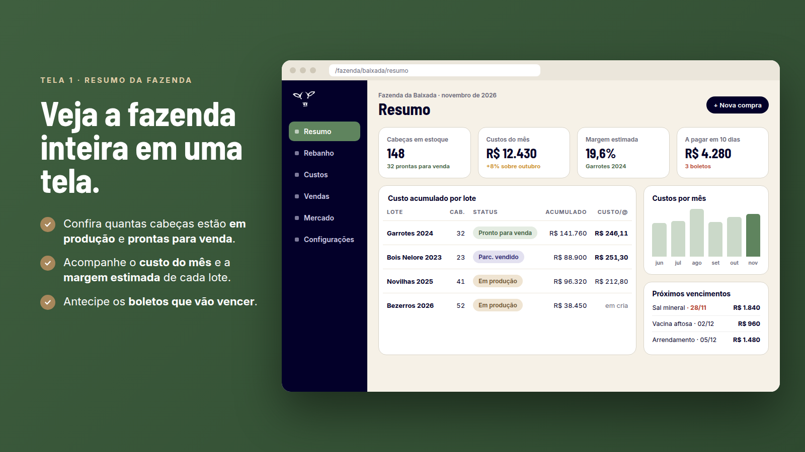
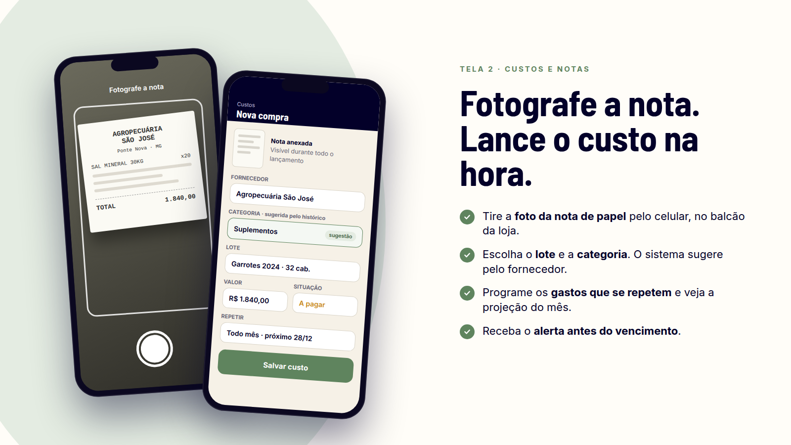
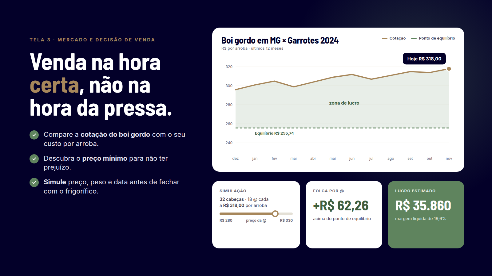
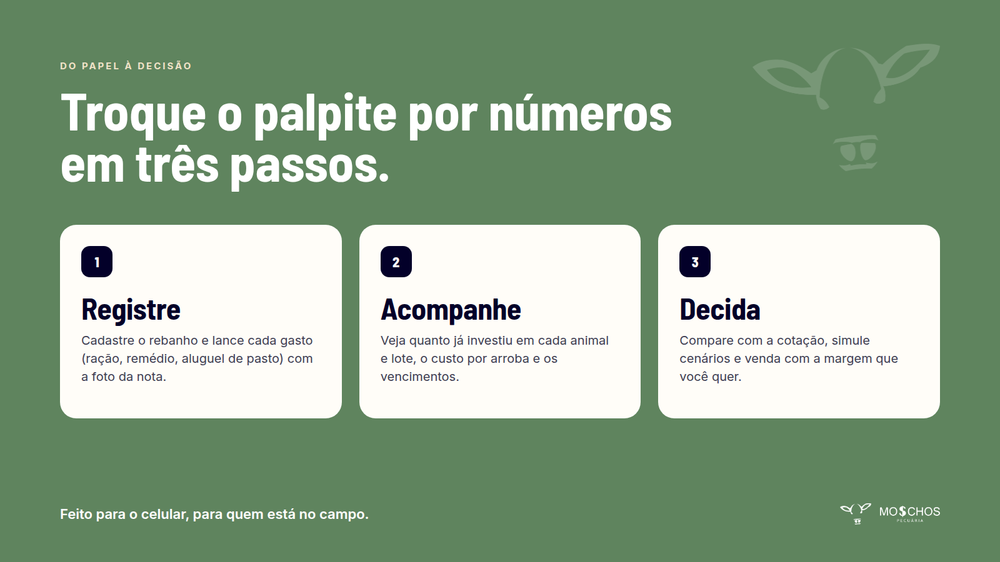

  

# Saiba quanto custa cada boi e venda na hora certa

Controle o rebanho, registre cada gasto e compare o seu custo com a cotação do boi gordo. Pare de decidir no olho: decida com números.

  

## Cada gasto conta na conta do boi

Um lote leva de 2 a 3 anos do pasto ao frigorífico. Nesse tempo, o dinheiro sai aos poucos, em gastos que ninguém soma: o saco de ração, a dose de vacina, o aluguel do pasto. Registre cada um deles no lote ou no animal e veja o investimento real de cada cabeça.

| Lance cada gasto | Exemplos |
| --- | --- |
| Compra dos animais | aquisição de bezerros e garrotes |
| Ração e suplementos | sal mineral, ração, silagem |
| Medicamentos e vacinas | vermífugo, aftosa, carrapaticida |
| Locação de pasto | aluguel da área onde o gado fica |
| Outros | frete, manutenção, mão de obra e as categorias que você criar |

Com os gastos somados, o sistema mostra quanto custou cada animal e cada lote, quanto custa cada arroba produzida e quanto voltou na venda. Assim você vê o lucro de verdade e descobre qual gasto pesa mais.

  

## O que você ganha

- **Saiba o que tem no pasto.** Cadastre o gado por lote ou por cabeça e veja o saldo de cada lote.
- **Saiba quanto gastou.** Fotografe a nota no celular e lance cada gasto (ração, remédio, pasto) no lote ou no animal certo, na hora da compra.
- **Saiba quanto investiu.** Veja o custo acumulado de cada animal e lote, separado por categoria.
- **Saiba quanto voltou.** Compare o investimento com o valor da venda e veja o custo por arroba, o ponto de equilíbrio e a margem bruta e líquida de cada venda.
- **Saiba quando vender.** Compare a cotação com o seu custo e simule preço, peso e data antes de fechar.
- **Planeje o mês.** Programe os gastos que se repetem e receba o alerta antes do boleto vencer.

## As telas que mais importam

  
  
  
  

> As telas acima são ilustrações com dados de exemplo

## Sobre o projeto (⚠️**Está em DESENVOLVIMENTO**⚠️)

| | |
| --- | --- |
| Para quem | Produtor de pecuária de corte familiar e quem gere a propriedade com ele. Pensado para quem tem pouca afinidade com tecnologia e usa o celular no campo. |
| Caso real | Propriedade de cerca de 70 ha e 150 cabeças em Piedade de Ponte Nova (MG), com ciclo de produção de 2 a 3 anos. |
| O que entra na v1.0 | Acesso e propriedades com papéis e convites, rebanho por lote ou por cabeça, notas fiscais por foto e custos com categorias, recorrência e vencimentos, vendas com margens, cotação do boi gordo com simulação e painel de resumo. |
| O que fica para depois | Cotação automática, leitura da nota por OCR, integração com NF-e, DDA e Open Finance, rateio de custos gerais e modo offline. |
| Tecnologia | React, TypeScript e Vite no front-end; FastAPI, SQLAlchemy, Alembic e PostgreSQL no back-end; Docker e GitHub Actions. |
| Situação | Em desenvolvimento. O trabalho está sendo realizado gradualmente, dentro do escopo definido até o momento |
| Contexto | Trabalho da disciplina CSI606 Sistemas WEB I, de Hálisson Piovezana |

 

## Para quem desenvolve (🚪️Forma de acessar apenas enquanto está em desenvolvimento)

Leia docs/arquitetura.md para entender a estrutura e as decisões adotadas. Os requisitos de negócio estão no arquivo Documento-Requisitos-Moschos-Pecuaria.md, que é a fonte oficial do escopo. Decisões de arquitetura ficam registradas em docs/adr. O modelo relacional está em db/, com a validação em docs/db/modelo-de-dados.md. O escopo da entrega v1.0 e o cronograma estão em docs/gestao.

## Execução local

Pré-requisitos: Node.js 22+, pnpm (ou `corepack enable`), Python 3.12+ e Docker.

~~~
cp .env.example .env
docker compose up -d db

cd backend
cp .env.example .env
python -m venv .venv
source .venv/bin/activate
pip install -e ".[dev]"
alembic upgrade head
uvicorn app.main:app --reload
~~~

As credenciais de desenvolvimento em .env.example (raiz) e backend/.env.example são as mesmas. Se alterar uma, altere a outra.

Em outro terminal:

~~~
cd frontend
cp .env.example .env
pnpm install
pnpm dev
~~~

O front-end abre em http://localhost:5173. O Vite encaminha as chamadas a /api para a API em http://localhost:8000 (proxy, ADR 0001), então a API precisa estar no ar para entrar no app; para outra porta, ajuste `API_PROXY_TARGET` em frontend/.env. A API responde em http://localhost:8000/api/v1/health, a conexão com o banco é verificada em http://localhost:8000/api/v1/health/db e a documentação interativa fica em http://localhost:8000/docs.

## Docker

~~~
cp .env.example .env
docker compose up --build
~~~

Use sempre `--build` depois de mudar o back-end ou trocar de branch: sem ele, o compose reaproveita a imagem antiga da API, e as rotas novas respondem 404. Se a porta 8000 já estiver em uso por outro projeto, a API não sobe direito (o container fica sem rede e não acha o host `db`). Nesse caso, defina `API_PORT=8001` no .env da raiz e `API_PROXY_TARGET=http://localhost:8001` em frontend/.env. O compose inicia PostgreSQL e API, aplicando as migrations na subida da API; durante o desenvolvimento o front-end roda localmente para manter o hot reload. No Linux, se aparecer "permission denied" no socket do Docker, adicione seu usuário ao grupo docker (`sudo usermod -aG docker $USER`) e abra uma nova sessão.
